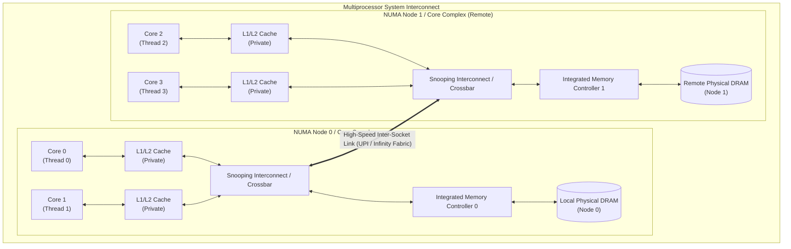
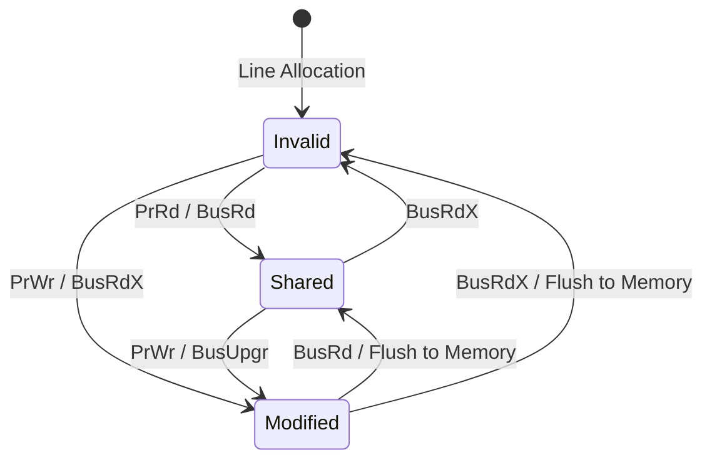
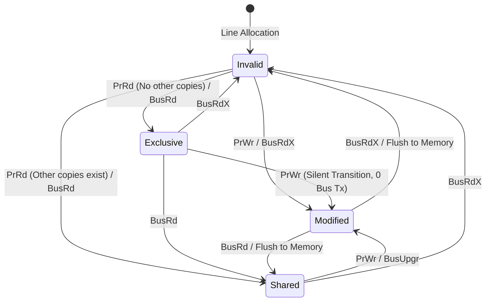
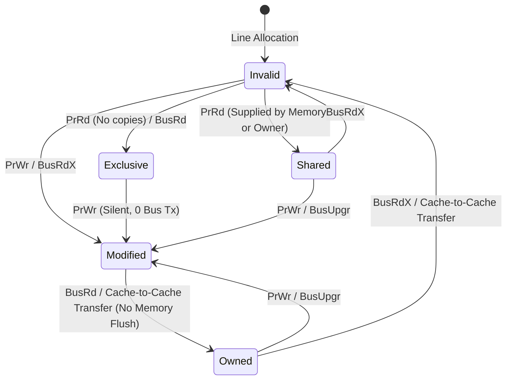
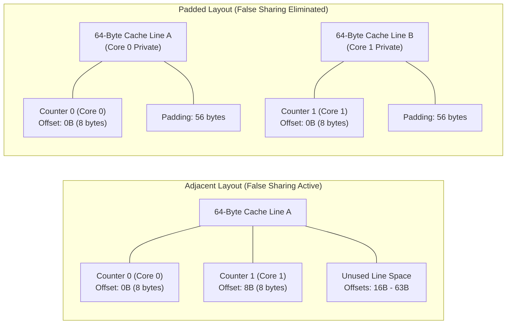
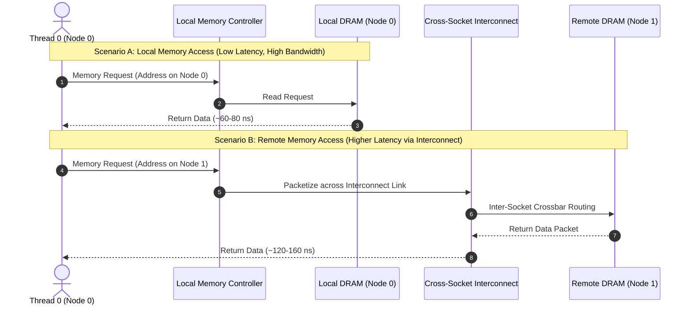

# System Architecture & Technical Diagrams

## 1. Multicore Shared-Memory Architecture

---

## 2. Cache Coherence Protocol State Transition Diagrams

### 2.1 MSI Protocol State Machine

### 2.2 MESI Protocol State Machine

### 2.3 MOESI Protocol State Machine

---

## 3. Cache-Line Memory Layout: Adjacent vs. Padded

---

## 4. NUMA Memory Placement and Access Latency

